<p align="center">
  
  &nbsp;&nbsp;&nbsp;&nbsp;
  
</p>


# Khumo Detection Fraud Systems for 2026 COS700 Research 

In fulfillment of the 2026 COS 700 research project for the BSc Honours in Computer Science at the University of Pretoria, under the supervision of Prof Jan Eloff.


## About

**Khumo Detection Fraud Systems** is a real-time fraud alert prototype for card-not-present (CNP) card fraud, built around a graph neural network (GNN). It was designed, built and evaluated as the research artefact of the COS 700 honours project *Real Time GNN based CNP Fraud Alert Prototype: a semi-supervised graph neural network with a reinforcement-learning decision agent*.

- **Author:** Khumo Rametse
- **Supervisor:** Prof Jan Eloff
- **Institution:** Department of Computer Science, Faculty of Engineering, Built Environment and Information Technology, University of Pretoria
- **Module:** COS 700 Research Project, BSc Honours in Computer Science, 2026

### Why it matters

CNP fraud, a purchase made with stolen card details rather than the physical card, accounts for most card fraud losses in South Africa, and SABRIC reports that most of those losses come from transactions made abroad. Detecting it is hard for three reasons that this project takes seriously:

- **Fraud is rare.** In the most widely used benchmark only 0.17% of transactions are fraud, so a model that never raises an alert looks almost perfectly accurate.
- **False alarms are expensive.** Every alert costs an investigator's time or a customer's patience, and a blocked card is a bad customer experience.
- **Labels are scarce and late.** A transaction is confirmed as fraud only after a chargeback or an investigation, often weeks later, and most transactions are never labelled at all.

Fraud is also relational: fraudsters reuse devices, cards, IP addresses and mule accounts. A GNN learns from those links directly, so a transaction that looks normal on its own can look suspicious next to the transactions it shares a device with.

**Method.** The work followed the design science research paradigm: the prototype was built and evaluated in four cycles, each ending in a finding that shaped the next.

| Cycle | What was built | What it showed |
|---|---|---|
| 1 | A GNN baseline trained with every label | The GNN separated fraud well but raised many false alarms, and testing on the full graph said nothing about live behaviour. |
| 2 | A test bench that scores the GNN live, one transaction at a time, using only earlier transactions | Full-graph testing overstated live performance (PR-AUC 0.992 against 0.865), and a train/serve mismatch in live scoring was found and fixed. |
| 3 | Semi-supervised training with 20% of labels arriving late, and a Deep Q-Network agent (after FraudGNN-RL) that sets the alert threshold, the weight of graph evidence and pseudo-labelling for each time window | Self-training and label propagation helped; the agent beat a fixed threshold but not the best fixed setting. |
| 4 | Automated detection (the agent decides every transaction and groups escalations into cases and rings), planted fraud rings and adversarial examples | The agent halved false alarms on synthetic South African data; one ring type was missed, and a one-edit attack evaded the GNN until adversarial training. |

**Data.** The European Cardholder dataset (284,807 transactions), IEEE-CIS (590,540 e-commerce transactions) and synthetic South African card data, always split by time (60% training, 15% validation, 25% test) and, from the third cycle on, with only 20% of labels revealed, arriving hours after the transaction.

### Key findings

- **Live scoring is the honest test.** The same GNN that looked almost perfect on the full graph (PR-AUC 0.992) reached 0.865 when scored live, and only after a train/serve mismatch in the live scoring had been fixed (it was 0.794 before).
- **The graph reduces false alarms.** Self-training raised PR-AUC from 0.691 to 0.705 on the European data and from 0.310 to 0.352 on IEEE-CIS. Label propagation through shared accounts and cards, with a higher threshold, cut IEEE-CIS false alarms by a third (1,619 to 1,103) while catching slightly more frauds.
- **The RL agent is no silver bullet.** It beat a fixed threshold on IEEE-CIS (F1 0.398 against 0.383) but not the best single setting chosen on validation data. On the synthetic South African data, deciding every transaction on its own, it halved the fixed threshold's false alarms (29 to 14) and did beat the best fixed setting (F1 0.603).
- **Oversampling was not needed.** With semi-supervised training, switching FSMOTE off raised the European GNN's PR-AUC from 0.705 to 0.801.
- **Rings are found only if their first members are.** A planted collusive-merchant ring was found as one clean case; a card-testing ring, a pattern seen only once with two labels, was missed.
- **A GNN that relies on one strong signal is easy to evade.** Transacting from the victim's home country made an optimised attack invisible to the GNN. Adversarial training restored detection and forced an adaptive attacker into four edits and a 95% smaller take per transaction.
- **It is fast and explainable.** On two CPU cores with no GPU, a transaction is scored in a median of 5 ms and explained, when flagged, in 36 ms. Every alert comes with feature attributions, graph evidence for each linked account, card or device, a counterfactual and a plain-language summary.

### Contributions

- A real-time fraud alert prototype (live monitor, alert queue with explanations, customer portal) around a two-layer relation-wise GNN written in NumPy and SciPy, which trains on a two-core machine without a GPU or deep-learning framework.
- An evaluation protocol that scores each test transaction using only earlier transactions, as a deployed system would.
- A semi-supervised training procedure and a DQN decision agent adapted to partial, delayed labels.
- An automated detector that records why it held back the suspicious transactions it did not escalate, and groups escalations into cases and rings.
- A test harness that plants fraud rings and adversarial examples with known members, including a white-box attack on the GNN.

The full write-up is in the COS 700 research report.
### The research

The project asked:

> *Can a graph neural network, trained semi-supervised and combined with a reinforcement-learning decision agent, detect card-not-present fraud in real time with fewer false alarms when only a small, delayed fraction of transaction labels is available, and can its decisions be explained?*

A Django test bench for one fraud model: a **graph neural network** (GNN). Upload any labelled card-transaction CSV and the app trains the GNN on it, then tests it three ways:

1. **Full graph.** The whole file is one graph; how well can the GNN separate fraud when it sees every connection?
2. **Live (streaming).** Transactions arrive one at a time and each sees only the past, exactly as the live monitor scores. This is the number to expect in production.
3. **Graph ablation.** The test set is rescored with each kind of link (account, card, device, IP, merchant) removed, and once with no links at all, to show what the GNN actually relies on.

It then replays the test period through the GNN in real time and raises alerts that explain themselves with graph evidence and behavioural signals.

Automation  always trains the GNN on the file's own revealed labels. Migration `0009` drops their tables however automation runs made earlier still display.

The **RL agent** section adds a reinforcement-learning agent (a Deep Q-Network, after FraudGNN-RL) on top of a semi-supervised version of the GNN, evaluated on the European Cardholder and IEEE-CIS benchmarks. See [RL agent](#rl-agent-semi-supervised-gnn--deep-q-network-rl) below.

**Evaluation figures from the report**

The figures below are taken from the COS 700 research report.

<p align="center">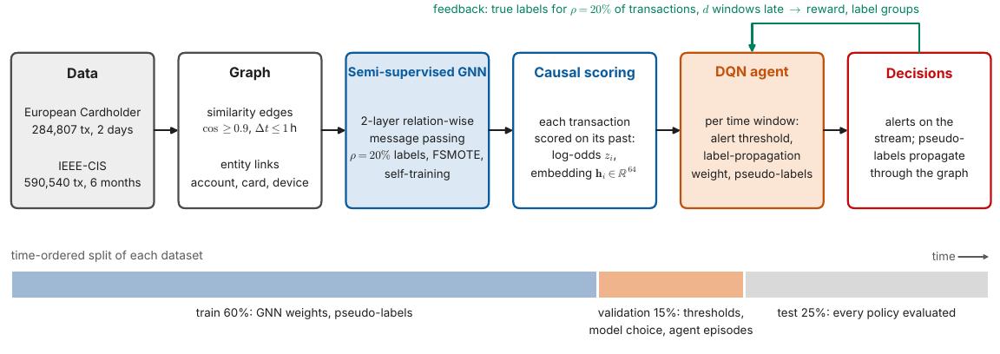</p> <p align="center"><sub>Overview of the final design: each dataset becomes a graph, a semi-supervised GNN is trained, every transaction is scored using only its past, and a DQN agent decides alerts window by window from partial, delayed labels.</sub></p>

**Cycle 2: full graph against live scoring**.

<p align="center">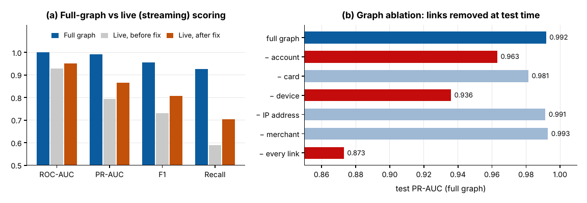</p> <p align="center"><sub>(a) The same GNN scored on the full graph and live, before and after the live-scoring fix. (b) Graph ablation: test PR-AUC with one relation's links removed, and with every link removed.</sub></p>

**Cycle 3: the RL agent on the European Cardholder and IEEE-CIS data**.

<p align="center">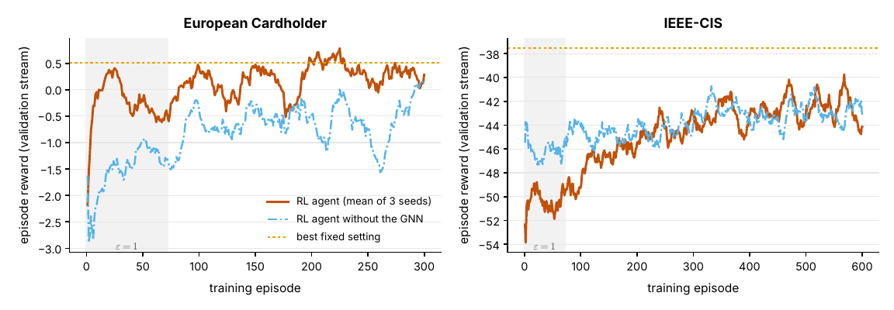</p> <p align="center"><sub>Reward per training episode on the validation stream, for the agent with and without the GNN. The dotted line is the best fixed setting.</sub></p> <p align="center">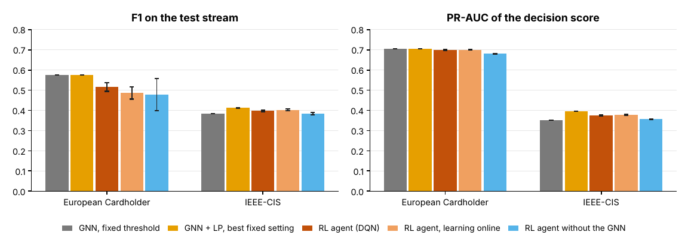</p> <p align="center"><sub>Test F1 and PR-AUC of each decision policy. Error bars are the standard deviation over three agents.</sub></p> <p align="center">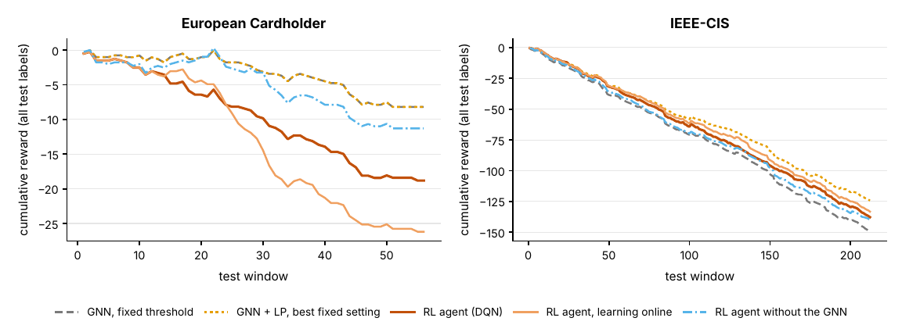</p> <p align="center"><sub>Cumulative reward over the test stream, scored on all test labels.</sub></p>

**Cycle 4: automated detection, oversampling, planted rings and adversarial examples**.

<p align="center">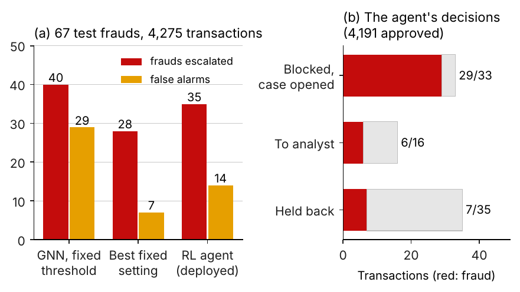</p> <p align="center"><sub>The agent as an automated detector on the synthetic South African test period: (a) frauds escalated and false alarms; (b) the agent's decisions.</sub></p> <p align="center">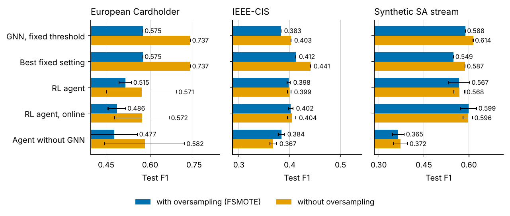</p> <p align="center"><sub>Test F1 of each decision policy with and without FSMOTE oversampling, on the three datasets.</sub></p> <p align="center">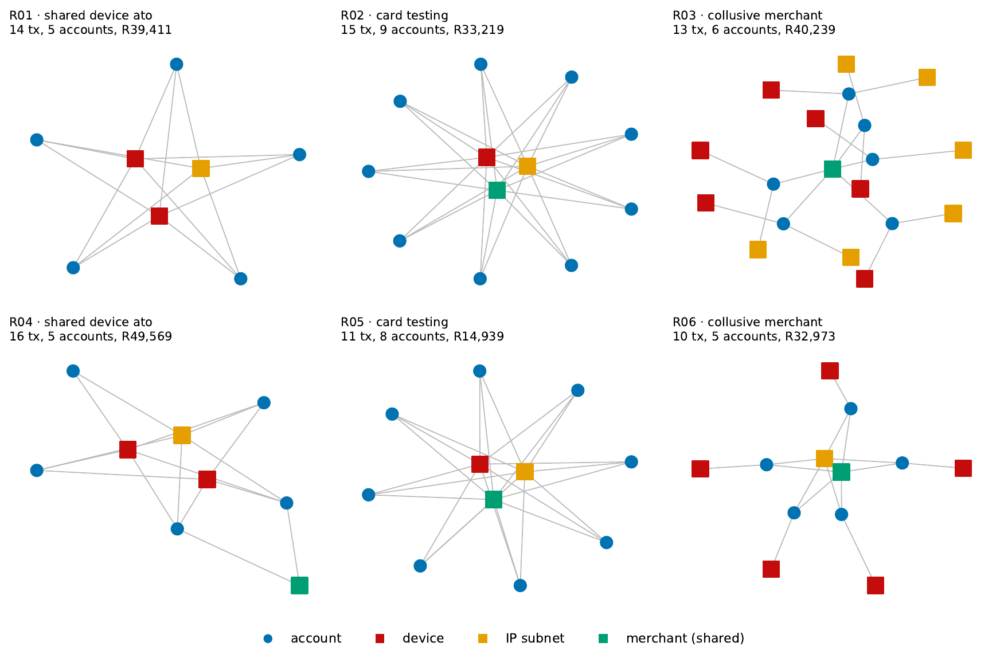</p> <p align="center"><sub>The six planted fraud rings: accounts and the devices, IP subnets and merchants they share.</sub></p> <p align="center">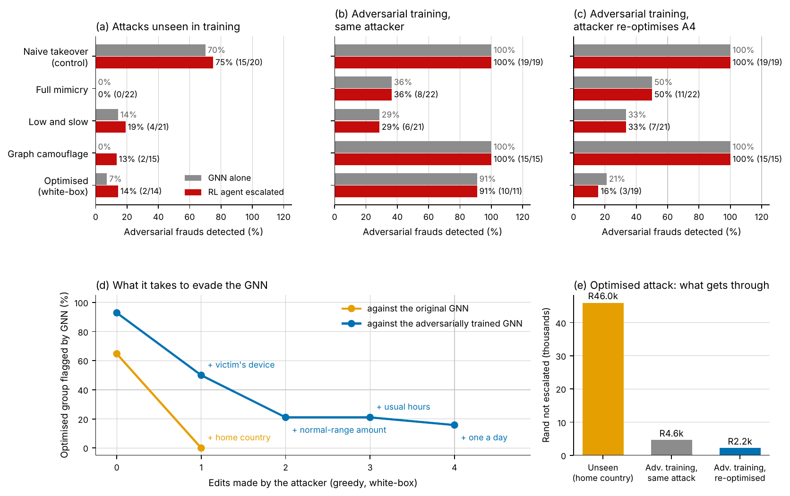</p> <p align="center"><sub>Adversarial examples: share of each attack group detected by the GNN alone and escalated by the agent, unseen in training, with adversarial training, and against an adaptive attacker; the white-box attack's path; and what gets through.</sub></p>


## Quick start

```bash
cd khumo-detection-fraud-systems
python -m venv .venv && source .venv/bin/activate      # Windows: .venv\Scripts\activate
pip install -r requirements.txt
python manage.py migrate
python manage.py createsuperuser      # your analyst login
python manage.py runserver
```

The analyst console at http://127.0.0.1:8000 needs a staff login. The customer portal lives at http://127.0.0.1:8000/my/.

Open http://127.0.0.1:8000, choose **Upload**, and drop in `creditcard_cnp.csv`. Training and testing take under a minute for 20,000 rows. After that the dataset page shows the GNN's test report, and **Open live monitor** starts the stream.

For big files you can train from the command line instead:

```bash
python manage.py train_dataset path/to/file.csv --name "My dataset"
```

## Pages

| Page | What it does |
|---|---|
| Datasets `/` | Every upload, its status and the GNN's F1 and PR-AUC (live if measured). |
| Upload `/upload/` | Upload a CSV. Columns are detected automatically and training starts in a background thread. |
| Dataset `/datasets/<id>/` | The GNN's test report: ROC-AUC, PR-AUC, F1, accuracy, precision and recall on the full graph and live; ROC curves; the **graph ablation**; confusion matrices; a **threshold sweep** (alerts, frauds caught, false alarms, precision, recall and F1 at thresholds from 0.05 to 0.95, plus the chosen one); and a behavioural-signal lift table. |
| Results `/results/` | Scorecards for the full-graph and live tests, a **full graph vs live** table showing what real-time scoring costs on each metric, and charts: ROC and precision–recall curves with the operating points, frauds caught vs missed, false alarms, score distributions and the GNN's training curve. Every chart has hover values, a toggling legend and a data table. A **with and without oversampling** comparison (see below). Then the whole **transaction graph**, and every trained dataset side by side with an F1-by-dataset chart. **Download CSV** exports all of it. |
| Automation `/automation/` | Upload a labelled card file; the GNN and the RL agent decide every test transaction (block and open a case, escalate, hold back with a reason, or approve). Optionally plant known fraud rings and adversarial examples and see how many were caught. |
| RL agent `/rl/` | Semi-supervised GNN + DQN experiments on the European Cardholder and IEEE-CIS data: start a run, then see each decision policy's results on the test stream, the agent's choices and learning curve, and the semi-supervised GNN against a fully supervised one. |
| Live monitor `/monitor/<id>/` | Streams the test period through the GNN over Server-Sent Events. Alerts appear as they fire. |
| Alert explanation `/alerts/<id>/` | Why the GNN flagged a transaction: a plain-language summary, the GNN score against its threshold, feature attributions, graph evidence and a counterfactual. |
| Customers `/customers/` | Enrol customers in the portal and see how many of their transactions were flagged and how many alerts they have replied to. |
| Alerts `/alerts/` | Review queue with "Confirm fraud" and "False alarm" buttons. New alerts also pop up on every page and as desktop notifications. |

## How it works

**Split.** Every row of the file is used; nothing is sampled away. Rows are sorted by time. The first 60% trains the GNN. The next 15% is used for early stopping and for choosing the alert threshold (the one that maximises F1). The last 25% is the test set, and every number on the results page comes from it. The live monitor replays the whole test period. If the later slices hold fewer than 5 frauds, a stratified split is used instead and the page says so.

**Class imbalance: FSMOTE** (`detector/ml/fsmote.py`). Fraud is usually well under 1% of transactions. Instead of sampling legitimate rows away, the training slice gets synthetic frauds from Fuzzy-SMOTE (Xu et al., 2017, *Int. J. Distributed Sensor Networks* 13(4), doi:10.1177/1550147717703116):

1. Each training fraud gets a fuzzy membership to the fraud class from its distances to the fraud and legitimate centroids (fuzzy c-means formula, m = 2, on standardised features).
2. Frauds with membership ≤ 0.7, the ones that look most like legitimate transactions, are the seeds. Each gets a share of the synthetic budget proportional to (1 − μ)/μ, so harder frauds get more neighbours.
3. Each synthetic fraud is x + λ·(neighbour − x) for one of the seed's 5 nearest fraud neighbours and λ ~ U(0, 1).
4. One-hot categories and 0/1 flags are copied from the nearer parent rather than averaged (as in SMOTE-NC). Whole-number columns such as transaction counts are rounded, so no synthetic row is recognisably synthetic.

The budget fills training up to the `FSMOTE_RATIO` frauds-to-legitimate ratio (default `1.0`, fully balanced). Set it to e.g. `0.5` for half, or `0` to switch FSMOTE off and fall back to class weights; that is useful as a baseline in a write-up. Any imbalance left after oversampling is handled with class weights. **Validation and test data are never oversampled**, so thresholds and every reported metric come from real transactions only.

Synthetic frauds can't simply be added to the graph as new nodes, because they would send messages into real transactions' neighbourhoods. As in GraphSMOTE (Zhao et al., 2021), a synthetic node is the same λ-mix of its two parents' inputs *and* graph neighbourhoods. It only receives messages, so real nodes are unaffected. The gradients are hand-derived and gradient-checked.

The results and dataset pages show how many synthetic frauds were added and from how many seeds.

**Behavioural features** (`detector/ml/behavior.py`). One `BehaviorState` processes transactions in time order. It keeps per-account profiles:

- amount mean and standard deviation, time since the last transaction
- 1-hour and 24-hour velocity
- devices, IPs, merchants and countries seen before

It also tracks how many accounts share each device and IP. Features only ever use an account's past. The same code runs at training time and at live scoring time, so the two cannot drift apart. The rules built on top of these features become the plain-language reasons shown on alerts, for example "Transaction in NG; this account normally transacts in ZA".

**The GNN** (`detector/ml/gnn.py`): a two-layer GraphSAGE-style network.

- Every transaction is a node, linked through the account, card, device, IP, merchant and terminal it shares with other transactions. Each entity type has its own weights. Files with no entity columns link transactions of the same amount bucket instead, both in training and live.
- Node features are the file's own columns plus the behavioural features above.
- It is written in NumPy and SciPy with hand-derived gradients and Adam, so PyTorch isn't needed.
- It is inductive: a new live transaction is scored from stored per-entity sums, which are then updated.

**How it's tested** (`detector/ml/pipeline.py`). The same trained GNN is evaluated two ways:

| Evaluation | What each test transaction sees | Answers |
|---|---|---|
| **GNN · full graph** (transductive) | The whole file as one graph, including later transactions on its account, device or IP (their features, never their labels) | How well can the GNN separate fraud given the complete graph? |
| **GNN · live** (streaming, inductive) | Only transactions before it. Each is scored, then joins the graph | What will the live monitor and the API actually achieve? |

The live test streams the validation period first (its threshold is chosen there, on live scores) and then the test period. The monitor and API alert at that live threshold, so the live test's numbers are what the monitor reproduces. In testing, replaying the test period through the monitor caught exactly the frauds the live test counted, with the same false alarms. The live test needs a time-ordered split; on a stratified split only the full-graph test runs.

The full-graph numbers are optimistic by design. A fraud ring or account takeover is often a burst, and on the full graph the first transaction of a burst can already see the rest. The gap between the two rows measures that.

**Graph ablation.** The test set is rescored on the full graph with one entity type's links removed (that type behaves as if every entity had only this one transaction), then with every link removed. The weights don't change, so the drop in PR-AUC shows how much the GNN depends on each relation. A large drop for "every link removed" means the graph adds real signal beyond the transaction's own features.

**Threshold sweep.** Alerts, frauds caught, false alarms, precision, recall and F1 on the test set at thresholds 0.05–0.95 plus the chosen one (live scores when available), for picking an operating point.

**Alert levels.**

- *Likely fraud*: the GNN score is at or above its live threshold.
- *Needs review*: the GNN score is below the threshold but at least a third of it, and the behavioural signal weight is 5 or more.

**Results on the synthetic test file** (27,335 rows from `generate_unlabelled` with the answer key joined as `is_fraud`, cut to the period that contains fraud; 148 frauds in the test period):

| Evaluation | ROC-AUC | PR-AUC | F1 | Precision | Recall |
|---|---|---|---|---|---|
| GNN · full graph | 0.9998 | 0.9917 | 0.955 | 0.986 | 0.926 |
| GNN · live | 0.9511 | 0.8653 | 0.806 | 0.946 | 0.703 |

Graph ablation (full-graph PR-AUC 0.992): without device links 0.936, without account links 0.963, without card links 0.981, IP and merchant links about unchanged, with no links at all 0.873.

**Live scoring fix.** Testing the GNN on its own exposed a train/serve skew in `score_one`. Training averages each entity's neighbourhood *including* the transaction being scored, but live scoring averaged only the earlier transactions. Live scores now include the transaction itself, and match the trained GNN run on the past-only graph (correlation 0.98 against an exact recomputation, up from 0.90). On the synthetic file this raised live PR-AUC from 0.794 to 0.865 and live F1 from 0.73 to 0.81. The transfer pipeline scores whole graphs with `predict_new`, so it was not affected.

## With and without oversampling

Every training run now trains the GNN twice on the same data, split and seed: once as configured (FSMOTE on by default) and once with oversampling switched the other way. Both versions choose their own alert threshold on validation data and are tested on the full graph and live. The Results page's **With and without oversampling** section shows them side by side: paired bars, and a table of ROC-AUC, PR-AUC, F1, precision, recall, accuracy, frauds caught, false alarms and frauds missed, with the better value in bold. The scorecards, the live monitor and the alerts keep using the configured version.

- **Older datasets:** a dataset trained before this was added shows a **Compare with and without oversampling** button. It reads the file again and trains only the other version, in the background, leaving the dataset as it is. Training is deterministic, so the configured side matches the scorecards exactly.
- **The study's ablation** is shown underneath for reference: test F1 of each decision policy with and without FSMOTE on the European Cardholder, IEEE-CIS and synthetic South African data, the GNN's PR-AUC and the fixed threshold's false alarms (from `detector/data/oversampling_study.json`).
- **Export:** **Download CSV** adds the other version's rows, labelled "(without oversampling)" or "(with FSMOTE)".
- **Switches:** `FSMOTE_RATIO=0` makes the version without oversampling the configured one. `OVERSAMPLING_COMPARISON=0` skips the second training for faster uploads.

Results on the two synthetic South African datasets bundled with the app:

| Dataset | Evaluation | PR-AUC with / without | F1 with / without | False alarms with / without |
|---|---|---|---|---|
| Synthetic ZA (time split, 27,335 rows) | Full graph | 0.992 / 0.996 | 0.955 / 0.966 | 2 / 2 |
| | Live | 0.865 / 0.872 | 0.806 / 0.817 | 6 / 4 |
| Synthetic ZA 20k (stratified split) | Full graph | 0.982 / 0.981 | 0.951 / 0.959 | 3 / 2 |

As in the study, oversampling did not help: the GNN without it was as good or slightly better.

## Transaction graph

The Results page draws the **whole** graph the GNN learns from (`detector/ml/txgraph.py`, `static/detector/graph.js`). Every transaction is a node linked to its account, card, device, IP address and merchant (and terminal, if the file has one). Fraudulent transactions are red, and entities that took part in fraud have a red ring.

- **Layout** is computed once at training time. Each account sits in the middle of its own cluster, with its cards, devices and IPs around it, and its transactions as a cloud of dots. Clusters are packed largest-first on a spiral. Clusters joined through shared devices or IPs are laid out by force. Very large ones are first coarsened (private devices and IPs orbit their only account), then laid out with a particle-mesh force layout. Merchants link almost every account, so they sit on an outer ring.
- **Fraud rings** are found on the fraud-only subgraph: accounts whose *fraudulent* transactions share a device, IP or card. Each is listed with the shared entities as evidence and zooms to them when clicked.
- **Exploring:** drag to pan; scroll or pinch to zoom. Hover any node for a summary. Click one to trace everything within two hops; the panel shows its details, and for a transaction its ID, amount, time, label and GNN score. You can also search for any account, card, device, IP or merchant, and toggle entity types. Keyboard: arrows pan, + and − zoom, 0 fits, Esc clears.
- **Scale:** a canvas renderer with culling and a cached bitmap while you move, so it stays usable at hundreds of thousands of transactions. On files over 60,000 transactions, merchant links start hidden because nearly every account shares them. Tick the box to draw them.
- **Download the edge list (CSV)** from the graph section (`/datasets/<id>/graph/edges.csv`) to open the same graph in Gephi or NetworkX.

## RL agent: semi-supervised GNN + Deep Q-Network (`/rl/`)

An experiment section that puts a reinforcement-learning agent on top of the GNN in a **semi-supervised** setting, on the two public benchmarks:

- **European Cardholder** (ULB, Kaggle `creditcardfraud`, `creditcard.csv`): 284,807 transactions over two days, 492 frauds.
- **IEEE-CIS** (Kaggle `ieee-fraud-detection`, `train_transaction.csv` + `train_identity.csv`): 590,540 transactions over six months, 3.5% fraud.

It follows two papers:

- **FraudGNN-RL** (Cui et al., *IEEE Open Journal of the Computer Society* 6, 2025, doi:10.1109/OJCS.2025.3543450). A DQN sits on top of the GNN. Its state is the graph embedding, its action is the detection threshold plus feature-importance weights (discretised), and its reward combines detection with false-positive cost. The Q-network has 2 × 128 hidden units and uses Adam at 1e-3 with batch 64. The agent keeps learning from feedback once deployed. For the anonymised European data, transactions are linked within a 1-hour window when their cosine similarity is above 0.9.
- **DRL+GNN** (Almasan et al., *Computer Communications*, 2022). The Q-value comes from a readout (sum/mean) of GNN hidden states. Exploration is ε-greedy, with ε = 1 for the first 70 iterations and exponential decay after. It uses a 4,000-transition FIFO experience replay and a discount of 0.95.

```bash
python manage.py train_rl --ulb creditcard.csv
python manage.py train_rl --ieee ieee-fraud-detection.zip          # or the unzipped folder
python manage.py train_rl --ulb creditcard.csv --label-rate 0.1 --agent-seeds 5
```

Runs also start from the **RL agent** page, which shows each run's results.

### The setting: few labels, late

Fraud labels come from chargebacks and investigations: only a fraction of transactions are ever confirmed, and weeks late. Every run hides all labels except a random `--label-rate` share (default 20%), for training and for feedback alike. Revealed labels arrive `--delay` windows after the transaction. All reported metrics use every true label, but no model or agent ever sees a hidden one.

### 1. The graph (`detector/ml/rl_data.py`)

- **European Cardholder.** The file has no account, card or device columns, so the graph is built from similarity, as in FraudGNN-RL. Each transaction links to at most 5 *earlier* transactions from the past hour whose standardised features have cosine similarity ≥ 0.9. Links only point backwards in time, so the graph is causal: a full-graph pass gives exactly the scores a live system would have computed.
  - On the real file this gives 745,422 links. Mean degree is 2.6 and 30% of transactions have no neighbour.
  - 60% of frauds have an earlier fraud among their neighbours, against 0.04% of legitimate transactions.
  - Lowering the threshold to 0.5 links every transaction but barely raises the fraud share (to 80%), so 0.9 is the default (`--knn-min-sim`).
- **IEEE-CIS.** Links go through the account (card1 + addr1 + P_emaildomain), the card (card1–card5) and a device fingerprint (DeviceInfo + OS + browser + screen + id_19/id_20). Node features (~80) are:
  - amount and its cents
  - ProductCD, card network and card type, and device type
  - C1–C14 counts
  - D-columns, with missing-value flags
  - M1–M9
  - distance, email flags and hour of day
  - the V block: V columns with at most 15% missing, compressed to 16 principal components fitted on the training period only.

### 2. The semi-supervised GNN (`detector/ml/semisup.py`)

1. The GNN trains on the revealed labels only. Every transaction, labelled or not, is in the graph, so unlabelled ones still shape their neighbours' embeddings (graph semi-supervised learning, Kipf & Welling 2017).
2. **Self-training.** Unlabelled training transactions the GNN is surest about become pseudo-labels for another round. Frauds need probability ≥ 0.9, capped at half the frauds the labelled prior predicts; a sample of the clearest legitimate transactions is added too. Pseudo-labels carry half weight. There are two extra rounds by default (`--rounds`).
3. The round kept is the one with the best PR-AUC on *labelled* validation transactions.
4. Two references are reported but never used in a decision: the same GNN trained on 100% of labels, and pseudo-label precision measured against the hidden labels.

### 3. The agent (`detector/ml/rl_agent.py`)

The validation and test periods are cut into time windows (10 minutes for the European data, 6 hours for IEEE-CIS). In each window the agent does the following:

| | |
|---|---|
| **State** | Readout: the mean of the GNN's hidden states over the window, projected to 16 dimensions. Also: the window's GNN score quantiles, how much label evidence its neighbours carry, the current settings, and running precision/recall from the labelled feedback received so far |
| **Action** | 7 × 3 × 3 = 63 combinations: the **alert threshold** (offset −2 … +2 log-odds from the validation threshold); the **label-propagation weight** w ∈ {0, 0.5, 1}; and the **pseudo-labelling confidence** (off, 0.99, 0.95) |
| **Score** | GNN log-odds + w × label-propagation evidence. The evidence is the smoothed fraud rate among labels (true and pseudo) held by the transaction's graph neighbours, as log-odds against the base rate, and is 0 with no evidence |
| **Reward** | On labelled transactions only: (caught − missed − false alarms) / (expected frauds + 1). Flagging pays once a transaction is fraud with probability above 1/3, which keeps the objective close to F1 (`--fp-cost`) |

The Q-network is an **action-branching DQN** (Tavakoli et al., AAAI 2018) with one Q-head per decision on a shared 2 × 128 torso. FraudGNN-RL's action is a vector, and a flat 63-output network learned less from the same data (see the development table below). Training uses double-DQN targets, a target network, the 4,000-transition FIFO replay and DRL+GNN's ε schedule. The discount is 0.5, not DRL+GNN's 0.95: an action reaches later windows only through the labels it propagates, and 0.5 was more stable. Each training episode replays the validation stream with a fresh random 20% of labels revealed. Pseudo-labels are chosen from the GNN's own confidence, not the propagated score; otherwise pseudo-labels feed on themselves and run away, which happened in development.

### 4. What is compared

On the test stream, every policy sees the same transactions, revealed labels and delay:

| Policy | |
|---|---|
| GNN, fixed threshold | The validation threshold, never changed (FraudGNN-RL's "w/o RL") |
| GNN + LP, best fixed setting | The single best action held for the whole stream, picked on the validation stream. This is the strongest non-adaptive baseline |
| RL agent (DQN) | Greedy, frozen after training |
| RL agent, learning online | Keeps learning from labelled feedback during the test stream |
| RL agent without the GNN | The GNN with every link removed (features only) under its own agent (FraudGNN-RL's "w/o GNN") |

The agent rows are averaged over `--agent-seeds` independently trained agents (default 3), with the spread shown. Metrics: ROC-AUC, PR-AUC, F1, precision, recall, false-positive rate, Recall@1% (FraudGNN-RL's practical metric) and the reward itself, both on labelled transactions (what the agent saw) and on all of them.

### Results on the real data

20% of labels revealed (seed 42). Agents are averaged over 3 seeds (± standard deviation). European Cardholder: 300 episodes, 10-minute windows, labels 3 windows late. IEEE-CIS: 600 episodes, 6-hour windows, labels a day late. Times are on a 2-core, 8 GB machine.

**Semi-supervised GNN** (test period, each transaction scored with only earlier transactions as neighbours):

| | European Cardholder PR-AUC | ROC-AUC | Recall@1% | IEEE-CIS PR-AUC | ROC-AUC | Recall@1% |
|---|---|---|---|---|---|---|
| Supervised only (20% of labels) | 0.691 | 0.955 | 0.830 | 0.310 | 0.813 | 0.188 |
| **Semi-supervised (self-training)** | **0.705** | 0.956 | 0.830 | **0.352** | 0.809 | 0.201 |
| Semi-supervised, links removed | 0.688 | 0.955 | 0.819 | 0.337 | 0.767 | 0.210 |
| Reference: 100% of labels | 0.746 | 0.966 | 0.851 | 0.385 | 0.840 | 0.206 |

Self-training closes a quarter of the gap to full labels on the European data and more than half of it on IEEE-CIS. Its pseudo-labelled frauds were 88% and 71% precise respectively. Removing the graph links costs PR-AUC on both datasets, and ROC-AUC heavily on IEEE-CIS. The F1 in the app's table depends on a threshold chosen from very few labelled validation frauds (9 on the European data), so compare the threshold-free columns.

**Decision policies on the test stream** (metrics use every true label):

| Policy | European F1 | PR-AUC | Caught / false alarms (of 94) | Reward, all labels | IEEE-CIS F1 | PR-AUC | Caught / false alarms (of 5,100) | Reward, all labels |
|---|---|---|---|---|---|---|---|---|
| GNN, fixed threshold | **0.575** | **0.705** | 63 / 62 | **−8.2** | 0.383 | 0.352 | 1,591 / 1,619 | −149.6 |
| GNN + LP, best fixed setting | **0.575** | **0.705** | 63 / 62 | **−8.2** | **0.412** | **0.395** | 1,610 / 1,103 | **−124.3** |
| RL agent (DQN) | 0.515 ± 0.021 | 0.699 | 65 / 95 | −15.8 ± 2.6 | 0.398 ± 0.003 | 0.375 | 1,654 / 1,564 | −139.1 ± 2.8 |
| RL agent, learning online | 0.486 ± 0.030 | 0.700 | 66 / 111 | −20.1 ± 4.6 | 0.402 ± 0.004 | 0.378 | 1,697 / 1,642 | −138.3 ± 5.1 |
| RL agent without the GNN | 0.477 ± 0.079 | 0.681 | 66 / 128 | −24.0 ± 15.8 | 0.384 ± 0.006 | 0.356 | 1,517 / 1,293 | −139.5 ± 1.9 |

What this shows, plainly:

- **The RL agent does not beat a well-chosen fixed setting on either dataset.** FraudGNN-RL reports large gains from its RL component; this replication doesn't reproduce them.
  - On IEEE-CIS the agent beats the fixed GNN threshold on F1, PR-AUC and reward, consistently across seeds.
  - It falls short of the best fixed setting picked on the same validation stream. Its training reward levelled off at about −42 per episode against that setting's −37.6.
  - On the two-day European file there are only 32 validation windows and about 9 labelled frauds per training episode. The agent learns noise and trails the fixed threshold.
- **Graph label propagation is the semi-supervised piece that pays most on IEEE-CIS.** Adding evidence from labelled neighbours (true labels and pseudo-labels on shared accounts, cards and devices) lifts PR-AUC from 0.352 to 0.395 and cuts false alarms by a third. The agent learned to use it: it chose weight 1 most often.
- **The GNN matters under the agent too.** With links removed, the same agent loses PR-AUC on both datasets, and its results vary far more on the European data. This matches FraudGNN-RL's "w/o GNN" ablation.

What was tried in development, with three agents each on the European data (validation reward / test F1):

| Configuration | Validation reward | Test F1 |
|---|---|---|
| Flat DQN over 63 actions, γ 0.95 | −0.11 ± 0.13 | 0.470 ± 0.057 |
| Action-branching DQN, γ 0.95 | 0.12 ± 0.34 | 0.464 ± 0.035 |
| **Action-branching DQN, γ 0.5 (default)** | 0.22 ± 0.27 | 0.515 ± 0.021 |
| Action-branching DQN, γ 0.5, 1,000 episodes | 0.06 ± 0.10 | 0.541 ± 0.054 |
| *Best fixed setting, for comparison* | *0.51* | *0.575* |

Two earlier designs failed and were dropped:

- Threshold *steps* (raise or lower from the current threshold) made credit assignment hard and drove the threshold up.
- Pseudo-labels chosen from the propagated score fed on themselves and ran away.

Ideas the results point to:

- Longer streams. IEEE-CIS's agent was still improving at 200 episodes and gained clearly by 600.
- A reward with less variance, for example estimating the value of unlabelled transactions with the reference GNN during training only.
- Treating the threshold as a continuous action, as FraudGNN-RL does with NAF.

### Timing

| Stage | European Cardholder | IEEE-CIS |
|---|---|---|
| Graph and features | ~1 min | ~30 s |
| Semi-supervised GNN (3 rounds + 100% reference) | ~7 min | ~70 min |
| DQN agents (3 seeds + ablation) | ~10 min | ~60 min |

Use `--max-rows`, `--epochs`, `--no-reference` and `--agent-seeds 1` for quicker runs. `python manage.py generate_rl_samples` writes synthetic look-alikes of both files for trying the pipeline without the Kaggle data.

## Automated detection: GNN + RL agent (`/automation/`)

This section runs fraud detection end to end on a labelled card file with no human in the loop. The GNN scores each transaction, and the DQN agent of `rl_agent.py` decides what happens to it. Fraud labels feed back to the agent as they arrive: only 20% of them, 6 hours late. The code is in `detector/ml/fraud_automation.py`.

**Pipeline**
1. **The GNN** is trained on the file's revealed labels (20%, from the first 60% of the file in time). It uses the shared behavioural features: amount against the account's history, velocity, balance share, new device/merchant/country, foreign, hour of day. It links transactions through account, card, device and merchant. Every transaction is scored using only earlier ones.
2. **The agent.** Three agents train on the validation period (2-hour windows, labels 3 windows late, 300 episodes). They are compared on the test period with the GNN at a fixed threshold and with the best single setting found on validation data.
3. **Automation.** The agent with the most validation reward runs the test period alone and keeps learning online. Every transaction gets one decision:

   | Decision | When |
   |---|---|
   | Blocked: case opened | Escalated, and linked to other escalations |
   | Escalated to analyst | Escalated on its own |
   | Not escalated (held back) | Suspicious (the GNN alone would have alerted, or the score is within 1 log-odds of the threshold), with the reason it was held back: the agent raised the threshold for that window, or graph evidence lowered the score |
   | Approved | Everything else |

4. **Cases and rings.** Escalations are linked as they arrive, by a shared card, device or IP address, the same account within 24 hours, or the same merchant within 72 hours (only between different accounts: a common cash-out point). A case spanning two or more accounts is a ring. Transactions that share a device or IP address with a ring member, or its account within an hour, but were not escalated, are listed separately.

**Command**
```bash
python manage.py automate_detection --target credit_card_clean.csv
```
Runs can also be started from the page. Each run writes:
- `decisions.csv`: every test transaction with its GNN score, graph evidence, the agent's threshold, decision, reason, case and ring.
- `automation.joblib`: the deployed agent and the GNN.

**Results on `credit_card_clean.csv`** (test period: 4,275 transactions, 67 frauds, 85 windows of 2 h):

| Policy | F1 | Caught / false alarms |
|---|---|---|
| GNN, fixed threshold | 0.588 | 40 / 29 |
| Best fixed setting | 0.549 | 28 / 7 |
| RL agent (mean of 3) | 0.567 ± 0.036 | 33.3 / 17.3 |
| RL agent, learning online (mean of 3) | 0.599 ± 0.027 | 35.3 / 15.7 |
| RL agent without the GNN (mean of 3) | 0.365 ± 0.020 | 18.7 / 16.7 |
| **Deployed agent** (online) | **0.603** | **35 / 14** |

The deployed agent halved the fixed threshold's false alarms (29 to 14) for five fewer frauds caught (precision 71%, recall 52%). It raised the threshold by the maximum in 61 of 85 windows. On this file it beat the best fixed setting, unlike on the European Cardholder and IEEE-CIS data.

Decisions on the 4,275 test transactions:
- **Blocked into a case:** 33 (29 fraud).
- **Escalated to an analyst:** 16 (6 fraud).
- **Held back:** 35 (7 fraud). The GNN alone would have alerted on 25 of them, including all 7 frauds.
- **Approved:** 4,191 (25 fraud).

Cases:
- **Bursts:** eight of the nine cases were single-account takeover bursts.
- **Ring:** the ninth was a ring of 8 escalations across accounts, all fraud, joined through a shared cash-out merchant.
- **Tied to the ring but not escalated:** 4 transactions, 3 of them fraud.

The file has no device or IP rings of the classic kind: none of its 180 frauds shares a device, IP address or card with another account. Fraud comes as account-takeover bursts, with several accounts compromised on the same days and cashing out at the same merchants.

### Planted fraud rings (`detector/ml/fraud_rings.py`)

The agent's ring grouping needs a ground truth to check against. `inject_rings` plants six rings of known members in a synthetic South African file, across the 60/15/25 time split. The agent learns from the earlier rings and meets new rings of the same kinds in the test period.

| Ring | Pattern | Period | What it looks like |
|---|---|---|---|
| R01, R04 | Shared-device account takeover | train, validation | 5 compromised accounts operated from 2 shared devices on one IP subnet, cashing out at high-risk online merchants within hours |
| R02, R05 | Card testing, then cash-out | train, test | 8–9 cards tried for R1–R9 at one online merchant from one device in under an hour, then 3 of them used for large purchases |
| R03, R06 | Collusive merchant | train, test | 5–6 accounts paying one complicit new merchant (gift cards, crypto exchange), each from its own device, with a few legitimate "cover" sales |

Existing rows keep their IDs and values. New rows get new IDs, and every derived field stays consistent: reference, dates, account sequence number, seconds since the account's previous transaction, and the running balance (capped so that no balance goes negative). Two new columns, `fraud_ring_id` and `fraud_pattern`, hold the ground truth. **They are for evaluation only.** No model feature reads them; a test checks that scrambling them leaves the features unchanged.

```bash
python manage.py inject_rings credit_card_clean.csv credit_card_rings.csv          # + credit_card_rings_ring_summary.csv
python manage.py automate_detection --target credit_card_clean.csv --inject-rings
```
On the Automation page, tick **Plant six known fraud rings**. When the file has `fraud_ring_id`:
- `decisions.csv` gains a `known_ring` column.
- The run page adds a **Planted fraud rings** section. It shows the labels revealed for each earlier ring, and for each test-period ring: frauds the GNN alone would flag, escalated, grouped into a ring case, held back and approved. It also gives the outcome and a network of the ring's accounts (coloured by decision), devices, IP subnets and merchants.
- `?decision=R05` on the decisions CSV filters to one ring, and `?decision=known_ring` to all planted rings.

**Results on `credit_card_clean.csv` with planted rings** (test period 4,297 transactions, 88 frauds):
- **Deployed agent:** escalated 50 of 88 frauds with 4 false alarms (F1 0.704). Not comparable with the 0.600 above, because the test set now holds the planted rings.
- **R06, collusive merchant:** caught as one ring case. 9 of its 10 transactions were blocked into case C007, which holds no other transactions. The agent missed only the first purchase, made before the merchant had any fraud history. Two purchases the GNN scored low (0.33 and 0.15) were escalated through graph evidence from linked labels.
- **R05, card testing:** missed. None of its 11 transactions was grouped into a ring case: one was escalated alone, one held back and nine approved. The only earlier example of the pattern is R02, and just 2 of its 15 labels were revealed, so the GNN never learnt it: the R1–R9 test charges scored below 0.1. Labels arrive 6 hours late, but the cash-outs came 3 hours after the tests, so the agent had no fraud labels on the shared device in time.
- **Lesson:** ring grouping depends on the GNN flagging a ring's first members. A ring type seen once, with almost no labels, gets through.

### Adversarial examples (`detector/ml/adversarial.py`)

This tests how robust the GNN and the agent are against an attacker who knows what the model looks at. The model sees:
- the amount compared with the account's history;
- time since the account's last transaction, and 24-hour velocity;
- the share of the balance spent;
- whether the device, merchant or country is new to the account, or foreign;
- the hour of day;
- the graph through account, card, device and merchant.

Each attack changes some of these. The fraud itself stays the same: money leaving a victim's account without consent. Five groups are planted, each on 8 victim accounts (2–3 transactions each):

| Group | What the attacker changes |
|---|---|
| C0 Naive takeover (control) | Nothing: a burst at night, a new device, often abroad, R2,000–R6,000 at cash-out merchants the victim never used |
| A1 Full mimicry | Everything: the victim's own device, home country, usual hours, amounts in the victim's normal range (its 90th percentile), merchants the victim uses, one a day |
| A2 Low and slow | Normal-range amounts, usual hours, home country, one a day; still a new device |
| A3 Graph camouflage | The naive fraud routed through the busiest legitimate device and merchant in the file, so its graph neighbourhood is overwhelmingly legitimate |
| A4 Optimised (white-box) | Starts as C0. The attacker queries the GNN, adds whichever edit (home country, usual hours, normal amount, known merchant, one a day, victim's device) lowers detection most, and repeats until the GNN flags none of the group |

With **adversarial training**:
- All five groups are also planted in the training period, with 20% of their labels revealed as usual. Camouflage there uses a different hub, so the model cannot memorise the test hub.
- A4 in training carries the attack found first.
- A4 in the test period is re-optimised against the retrained GNN: an adaptive attacker.

The attacked file stays consistent: original rows are unchanged, derived fields are recomputed, and no balance goes negative. The ground-truth columns `adversarial_group`, `adversarial_attack` and `adversarial_period` are for evaluation only; a test checks the features ignore them.

```bash
python manage.py inject_adversarial credit_card_clean.csv credit_card_adversarial.csv [--adversarial-training]
python manage.py automate_detection --target credit_card_clean.csv --adversarial [--adversarial-training]
```
On the Automation page, tick **Plant adversarial examples** and, optionally, **Adversarial training**. The run page then adds an **Adversarial examples** section:
- per group: rand per transaction, GNN alone, agent escalated, held back, approved, and rand not escalated;
- the white-box attack's path, step by step, with every edit it tried;
- the false alarms, and how often the agent lowered its threshold.

`?decision=A4` (or `adversarial`) filters the decisions CSV.

**Results on `credit_card_clean.csv`** (20% of labels arriving 6 h late; share of each group's test transactions detected by the GNN alone / escalated by the agent):

| Group | Unseen in training | Adversarial training, same attacker | Adversarial training, attacker re-optimises A4 |
|---|---|---|---|
| C0 Naive (control) | 70% / 75% | 100% / 100% | 100% / 100% |
| A1 Full mimicry | 0% / 0% | 36% / 36% | 50% / 50% |
| A2 Low and slow | 14% / 19% | 29% / 29% | 33% / 33% |
| A3 Graph camouflage | 0% / 13% | 100% / 100% | 100% / 100% |
| A4 Optimised | 7% / 14% (edit: home country) | 91% / 91% | 21% / 16% (edits: victim's device, normal amount, usual hours, one a day) |
| A4 rand not escalated | R46,000 | R4,600 | R2,200 |
| Original frauds escalated (of 67) | 39 | 43 | 49 |
| False alarms | 33 | 35 | 66 |

- **One edit beats the GNN.** Transacting from the victim's home country took the optimised group from 65% flagged to 0%, with large amounts intact. The model has learnt the shortcut "foreign means fraud".
- **Graph camouflage hides fraud completely from the GNN.** A busy legitimate neighbourhood outweighs the fraud's own signals.
- **The agent adds a little robustness, at a price.** It catches some camouflaged and optimised frauds through fraud labels on linked accounts and cards. But as late labels reveal missed frauds, it lowers its threshold: in 20% of windows against 7% on the clean file, and false alarms rose from 14 to 33.
- **Adversarial training makes evasion expensive, not impossible.** Naive, camouflage and the known optimised attack are caught again, and camouflage is caught even through an unseen hub. The re-optimising attacker now needs four edits, including taking over the victim's own device. Even then 16% are still escalated, and the take falls from about R3,700 to about R170 per transaction.
- **Mimicry stays the hardest.** It is also the least profitable: it is limited to amounts the victim normally spends.
- **Caveats:**
  - Groups are small (11–22 test transactions), so one transaction moves a percentage by 5–9 points.
  - A few A3 and A4 transactions fall in the validation period and are not scored.
  - Victims differ between scenarios.
  - Treat false alarms with care: the adaptive run's 66 shows the agent becomes unstable once attacks enter training.

Results, the attacked files and the figure are in `results/adversarial_sa/`.

## Customer portal (`/my/`)

A separate site where each customer watches **only their own account**.

- **Live activity.** The page checks for new transactions every 3 seconds. Every transaction on the account appears the moment the live monitor or the scoring API processes it, marked *Normal*, *Being checked* or *Flagged as suspicious*.
- **Real-time alerts.** A flagged transaction triggers an on-screen notice, a browser notification (if the customer allows them) and an unread count in the tab title. It also sends an email to the customer if they have an address saved and email alerts turned on.
- **"Did you make this transaction?"** Each flagged transaction has two buttons. The customer's answer ("it was me" or "not me") appears on the analyst's alert list and alert page.
- **Customer-safe reasons.** Customers see the behavioural reasons in plain words, such as "Transaction in NG; your account normally transacts in ZA". They never see model scores, feature attributions or SHAP values, because telling a fraudster which signals the models react to would help them avoid detection.

**Enrolling customers:**

- *Self-service* at `/my/signup/`. The account number is checked against the last four digits of a card on that account; this uses the `card_last4` column in the dataset. The error message is the same whether the account or the card is wrong, so the form can't be used to discover which account numbers exist.
- *By an analyst* on the **Customers** page.
- *From the command line:*
  ```bash
  python manage.py create_customer --dataset 1 --account ACC0034401 --username michael --password 'Str0ng-pass-99' --email you@example.com
  ```

Only enrolled accounts are recorded, and each customer's recent earlier transactions are copied in when they enrol.

**Demo.** Enrol `ACC0034401`; its card ends in `3700`. Sign in at `/my/` in one browser window. In the analyst window, open the Live monitor, set *Start at transaction* to `1900` and start the stream. Four fraudulent transactions from Nigeria reach the customer at transactions 3,919–3,937.

**Access rules:**
- Customers can't open analyst pages; they are sent back to `/my/`.
- Customer logins are refused at the analyst sign-in, and staff logins at the customer sign-in.
- A customer can only reply to alerts on their own account. For anyone else's alert they get "not found", which doesn't reveal that it exists.
- Set `ANALYST_LOGIN_REQUIRED=0` to switch off the staff login for local experiments.
- Set `CUSTOMER_LOGIN_REQUIRED=0` to switch off the customer sign-in for demos. `/my/` then lists the enrolled customers, and you pick whose dashboard to open; **Switch customer** takes you back to the list. Each dashboard still only shows and answers alerts for its own account.
- Set `SCORING_API_KEY` to require an `X-Api-Key` header on the scoring API.

## Explainable AI (XAI)

Every flagged transaction gets an explanation of the GNN's decision at the moment it's scored (`detector/ml/explain.py`). It's stored on the alert and shown on its page, in the live-monitor card, in the email and in the API response.

Attributions are in **log-odds**, the GNN's output before the sigmoid. The GNN is often near-certain, and at 99.99% a probability barely moves whatever is changed, so probability-point attributions would all read zero. +1 log-odds multiplies the odds of fraud by about 2.7, and +2.3 by 10.

- **Plain-language summary.** Built from the riskiest graph link and the strongest feature drivers. For example: "The GNN flagged it mainly because its account ZA101528 links it to 11 earlier transactions whose pattern the GNN reads as risky, the account made 6 transactions within an hour and …" When hiding that link alone would drop the score under the threshold, the summary says so.
- **Feature attribution.** Each feature group is swapped for its value in 12 legitimate training transactions, the GNN rescores the transaction against the same graph neighbourhood, and the average drop in log-odds is recorded. A feature group is a numeric column, a whole categorical column or one behavioural feature.
- **Graph evidence.** The GNN rescores the transaction with each linked entity (account, card, device, IP, merchant, terminal) hidden in turn. It shows the change in log-odds, what the GNN would score without that link, and how many earlier transactions and accounts share the entity.
- **Counterfactual.** The top drivers are reset one more at a time until the GNN score falls below its alert threshold.

Limits:
- Occlusion shares credit between correlated features.
- Hiding an entity replaces its neighbourhood term with the transaction's own, so a single link can move the log-odds a long way in either direction. Read graph evidence as "what this link contributes to the GNN's decision", not as a calibrated probability.
- The V-columns are anonymised, so they can be ranked but not described.

## Screenshots of Prototype
Screenshots

Click a screenshot to open it at full size. The data is synthetic.

<table> <tr> <td width="50%" valign="top"><a href="docs/images/screenshot-datasets.png">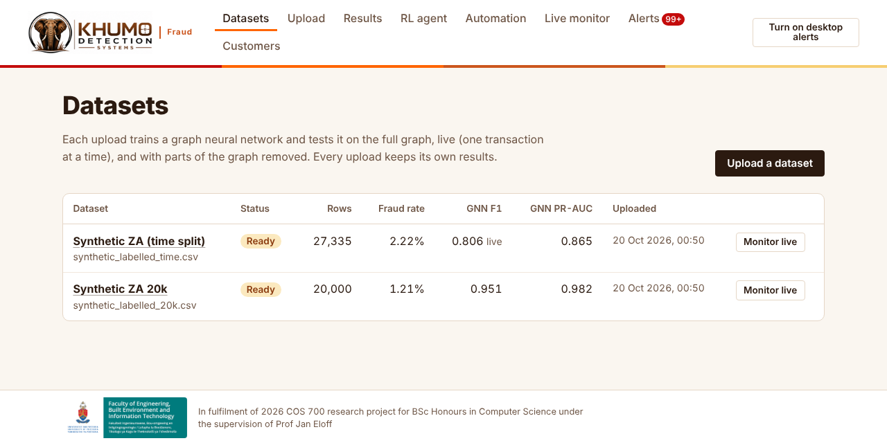</a><br><sub>Datasets: every upload with the GNN's F1 and PR-AUC</sub></td> <td width="50%" valign="top"><a href="docs/images/screenshot-dataset-report.png">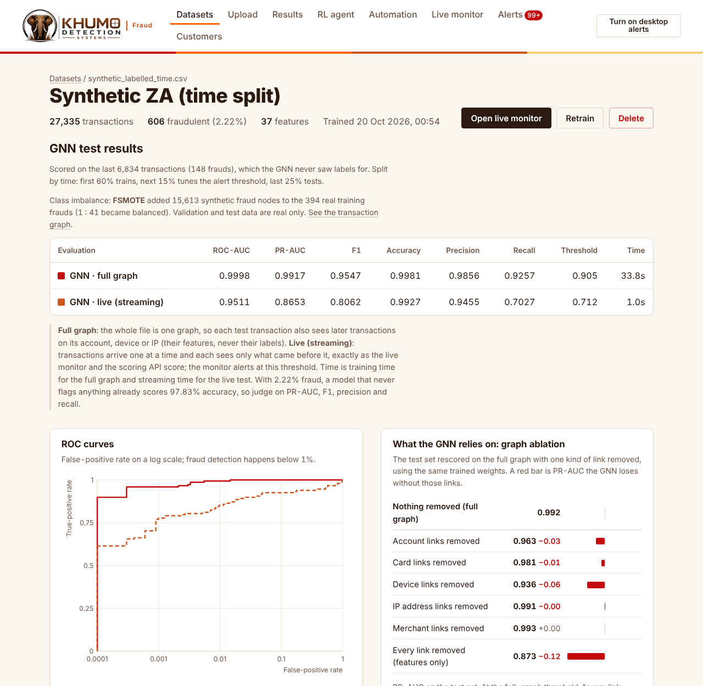</a><br><sub>Dataset report: full-graph and live test results, ROC curves and graph ablation</sub></td> </tr> <tr> <td width="50%" valign="top"><a href="docs/images/screenshot-results.png">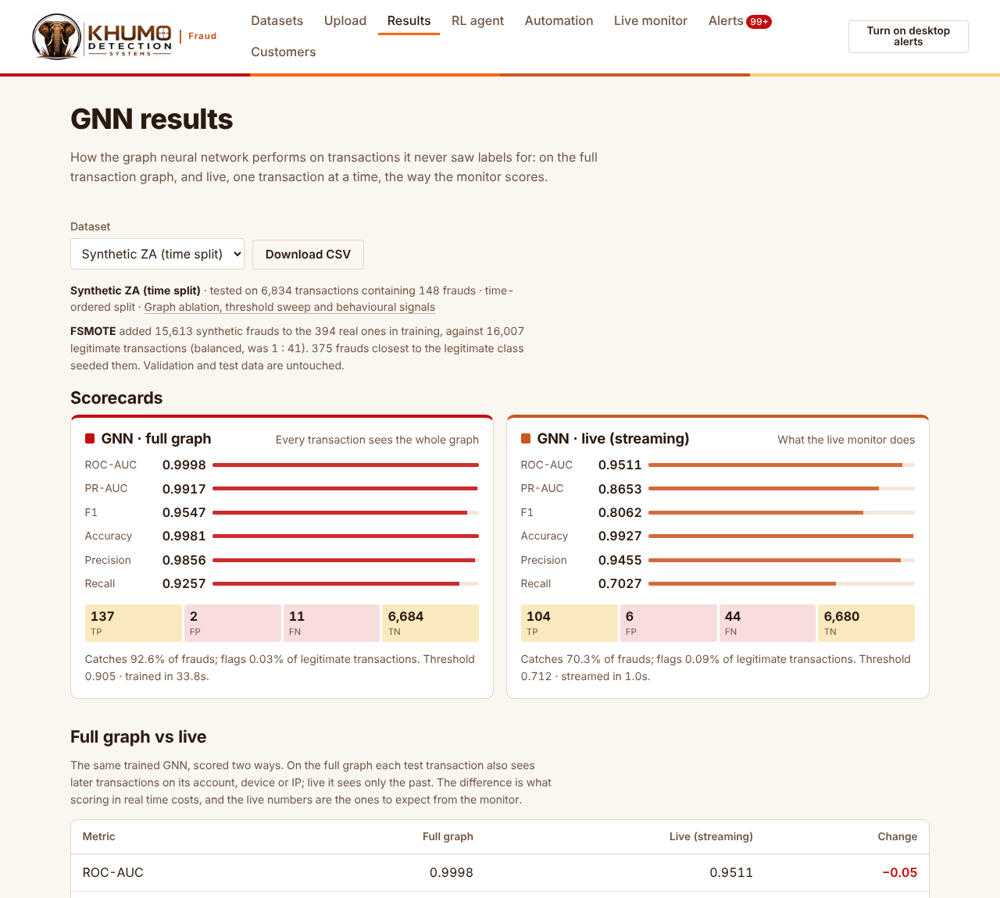</a><br><sub>Results: scorecards for the full-graph and live tests</sub></td> <td width="50%" valign="top"><a href="docs/images/screenshot-oversampling.png">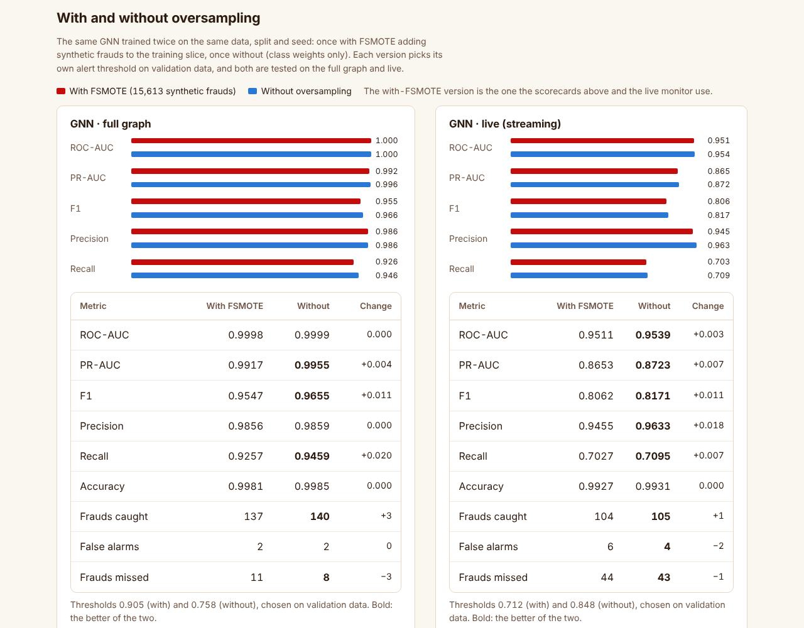</a><br><sub>Results: the GNN with and without oversampling, side by side</sub></td> </tr> <tr> <td width="50%" valign="top"><a href="docs/images/screenshot-transaction-graph.png">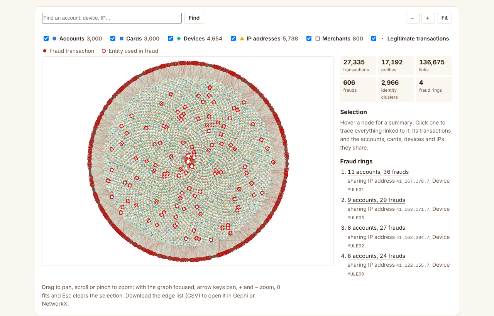</a><br><sub>Results: the whole transaction graph with fraud rings</sub></td> <td width="50%" valign="top"><a href="docs/images/screenshot-live-monitor.png">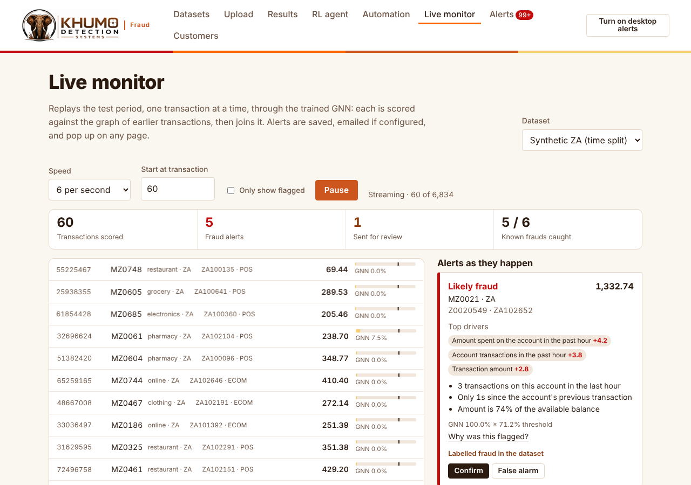</a><br><sub>Live monitor: the test period streamed through the GNN, with alerts as they fire</sub></td> </tr> <tr> <td width="50%" valign="top"><a href="docs/images/screenshot-alerts.png">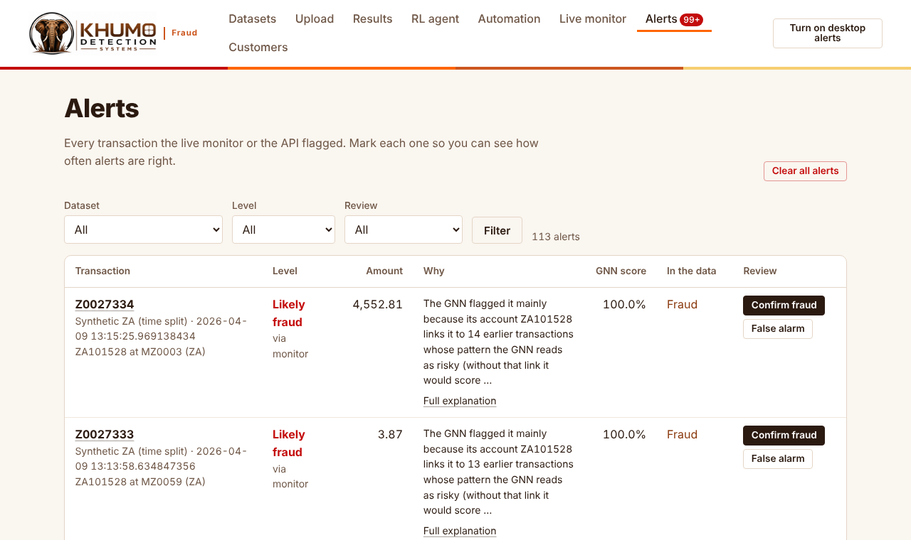</a><br><sub>Alert queue with confirm and false-alarm buttons</sub></td> <td width="50%" valign="top"><a href="docs/images/screenshot-alert-explanation.png">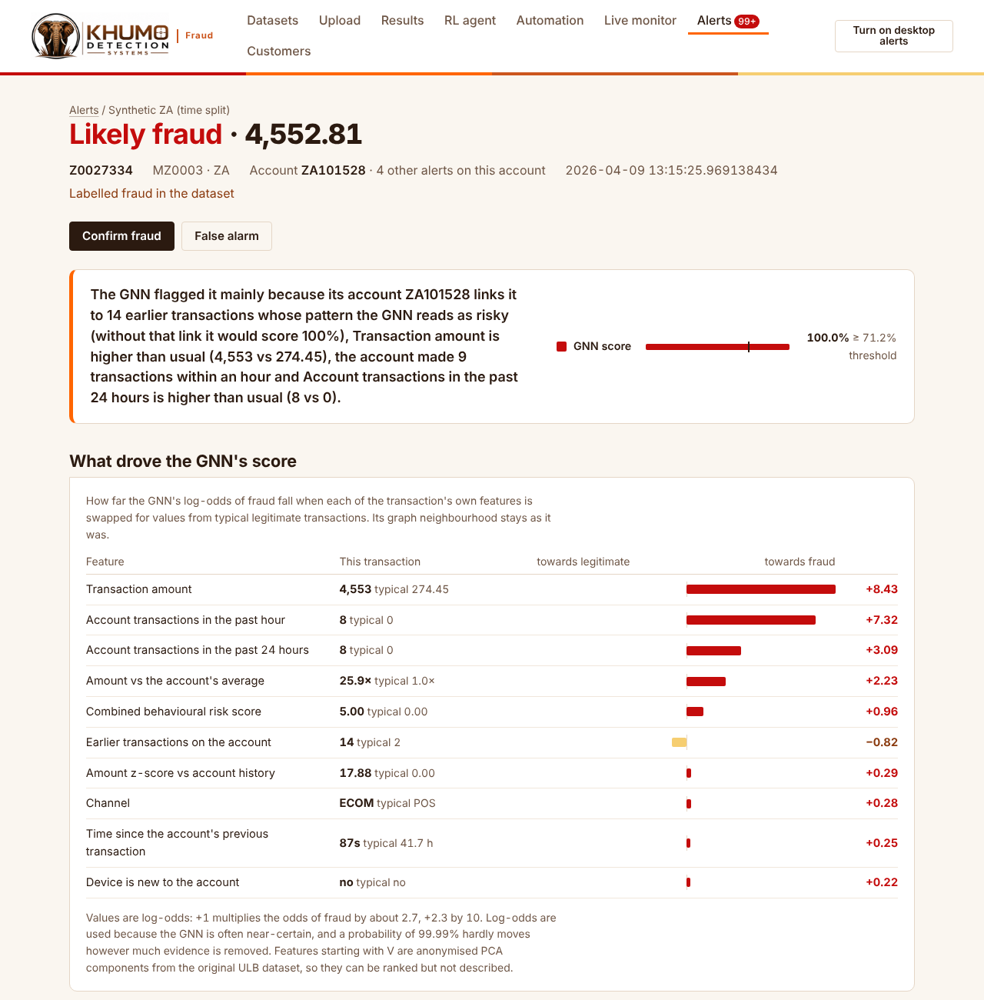</a><br><sub>Alert explanation: feature attributions, graph evidence and a counterfactual</sub></td> </tr> <tr> <td width="50%" valign="top"><a href="docs/images/screenshot-rl-agent.png">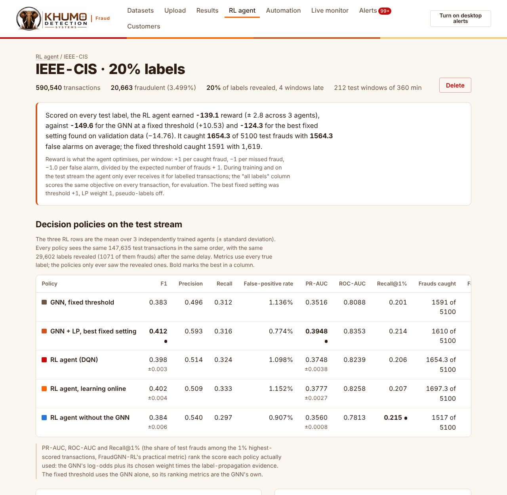</a><br><sub>RL agent: decision policies on the IEEE-CIS test stream</sub></td> <td width="50%" valign="top"><a href="docs/images/screenshot-automation.png">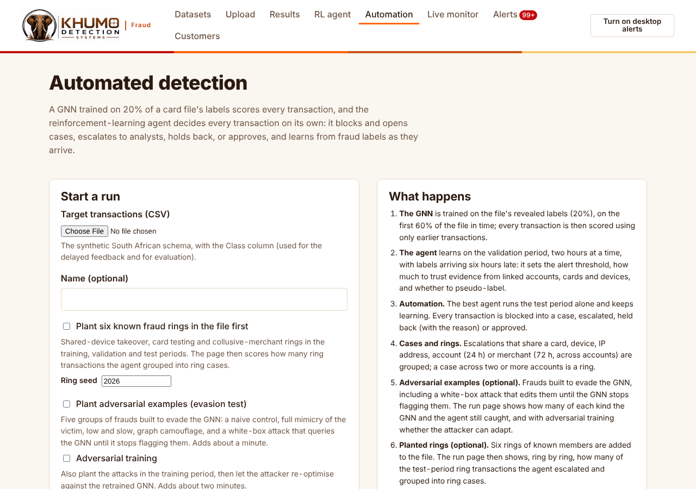</a><br><sub>Automated detection: start a run, optionally with planted rings and adversarial examples</sub></td> </tr> <tr> <td width="50%" valign="top"><a href="docs/images/screenshot-automation-rings.png">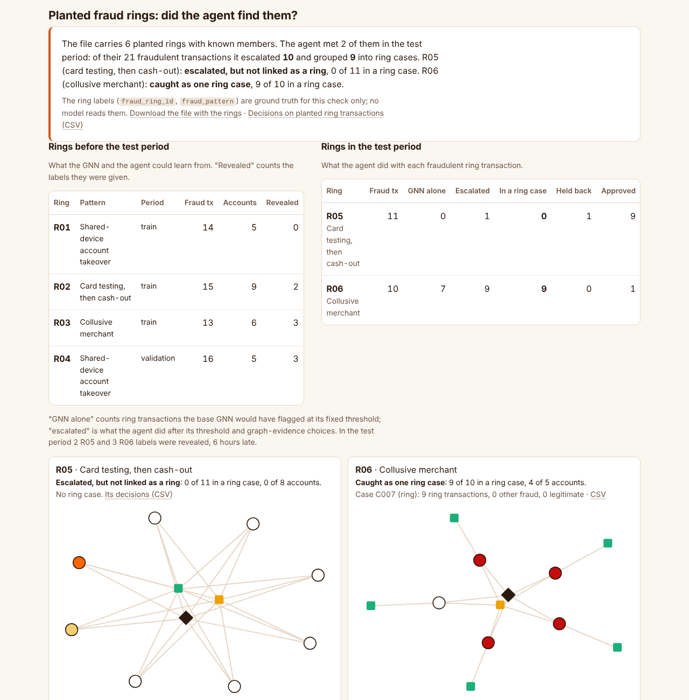</a><br><sub>Automated detection: did the agent find the planted fraud rings?</sub></td> <td width="50%" valign="top"><a href="docs/images/screenshot-automation-adversarial.png">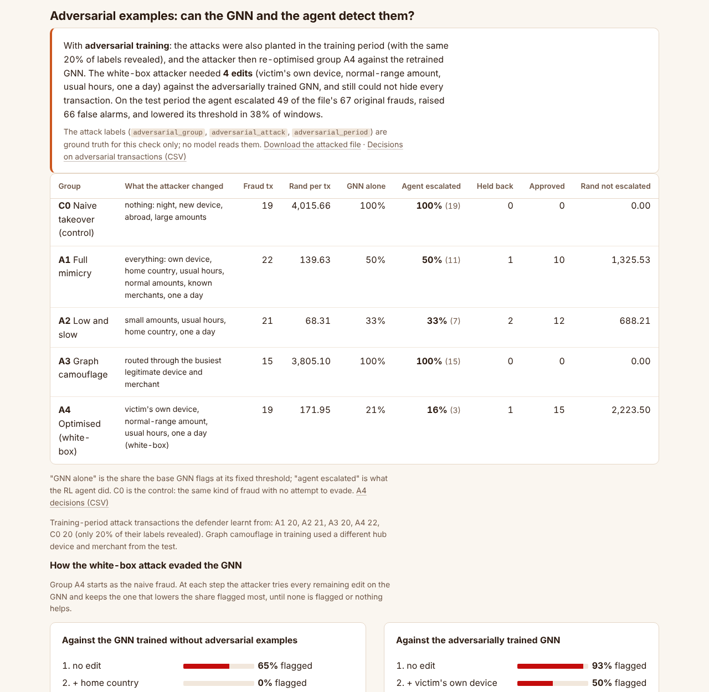</a><br><sub>Automated detection: adversarial examples and the white-box attack path</sub></td> </tr> <tr> <td width="50%" valign="top"><a href="docs/images/screenshot-customer-portal.png">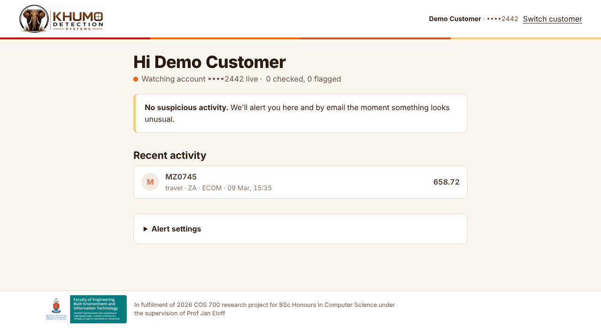</a><br><sub>Customer portal: an account holder's view of their transactions and alerts</sub></td> </tr> </table>


## Email alerts

By default, emails are printed to the console. To send real mail:

```bash
export ALERT_EMAIL_TO=you@example.com
export EMAIL_HOST=smtp.gmail.com EMAIL_PORT=587 EMAIL_USE_TLS=1
export EMAIL_HOST_USER=you@gmail.com EMAIL_HOST_PASSWORD=app-password
export ALERT_EMAIL_LEVELS=fraud          # or fraud,review
```

## Scoring API

```bash
curl -X POST http://127.0.0.1:8000/api/datasets/1/score/ \
  -H "Content-Type: application/json" \
  -d '{"transaction": {"transaction_id": "T1", "timestamp": "2013-09-25 03:12:00",
       "account_id": "ACC0012700", "Amount": 4999, "tx_country": "NG",
       "device_id": "DEVnew", "channel": "ECOM"}}'
```

Send `{"transactions": [...]}` to score a batch. Use the dataset's own column names. Missing numeric values fall back to training medians and missing categories to the most common value. Each call updates the account's history, so send transactions in time order.

## What a dataset needs

- A 0/1 label column named `Class`, `isFraud`, `is_fraud`, `fraud`, `label` or `target`.
- Some feature columns.
- At least 20 frauds.
- Optionally, a timestamp and entity IDs (`account_id`, `card_token`, `device_id`, `ip_address`, `merchant_id`, `terminal_id`) for the behavioural signals and the graph. Other common names are recognised too; see `detector/ml/schema.py`.

Files without real labels are rejected with an explanation. The IEEE-CIS `sample_submission.csv` is one example: it contains only an ID and `isFraud = 0.5` on every row. Every row is used for training, however large the file.

## Branding

The logo and favicon live in `detector/static/detector/img/`. The brand palette is defined once, as CSS variables at the top of `detector/static/detector/app.css`:

| Colour | Hex | Used for |
|---|---|---|
| Alarm red | `#C40C0C` | Fraud alerts, mistakes in confusion matrices, the full-graph GNN series |
| Signal orange | `#FF6500` | Review alerts, active navigation, focus rings |
| Elephant rust | `#CC561E` | Button hover, the live (streaming) GNN series, which is also drawn dashed |
| Savanna gold | `#F6CE71` | Correct decisions in confusion matrices, risk meters, review backgrounds |

The Django project package is `kdfs`, and the app is `detector`.

## Notes and limits

- **Datasets trained by an earlier version** keep their GNN result on the Results and dataset pages (the other models' rows are hidden), but they need a **Retrain** before the live test, ablation, sweep and live monitor are available. Alerts raised by earlier versions show a note instead of an explanation.
- Full-size files take a while. The GNN's training and the streaming test dominate; a 285,000-row file streams about 114,000 validation and test transactions one at a time. Use `python manage.py train_dataset` for big files so the browser isn't involved; it prints the results and the ablation when done.
- SMOTE-family oversampling doesn't always help; on some data the GNN scores better with class weights alone. The Results page compares both on every dataset (see [With and without oversampling](#with-and-without-oversampling)).
- `FuzzySMOTE.synthesize()` still turns an FSMOTE plan into plain feature rows, if you want to compare the GNN against a tabular baseline outside the app.
- Run the tests with `python manage.py test detector`.
- Training runs in a thread inside the web process, which keeps the app free of extra infrastructure. For production, move `tasks.start_training` to Celery or RQ and serve with a real WSGI/ASGI server.
- On `creditcard_cnp_20k-1.csv`, much of the predictive power comes from the ULB PCA columns (V17, V12, V14). Scores on data without those columns will be lower.
